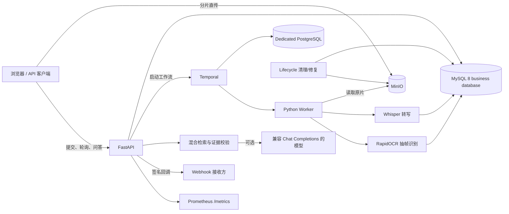

# Video Evidence Agent 架构与技术选型

## 处理链路

上传文件不经过 API 进程转发，客户端使用预签名 URL 直接写入对象存储。API 只保存上传、任务和租户元数据。Temporal 持久化长任务状态，Worker 将语音转写与幻灯片 OCR 并行执行，随后写入带时间区间的证据并建立关键词与向量索引。问答阶段只允许引用检索并校验通过的证据；证据不足时明确拒答。

## 关键选型

| 组件 | 选择 | 原因与边界 |
| --- | --- | --- |
| API | FastAPI | 异步接口与类型校验简单；当前限流是单进程内存实现，多副本部署需迁移到 Redis 或网关 |
| 工作流 | Temporal | 支持活动重试和进度持久化；外部副作用仍须依赖幂等键和 Webhook 事件 ID 去重 |
| 业务数据库 | MySQL 8 | 业务事实数据唯一来源；Alembic 迁移，JSON 向量由应用层计算相似度 |
| Temporal 数据库 | 独立 PostgreSQL | 仅保存 Temporal 内部状态，不与业务表混用 |
| 对象存储 | MinIO / S3 API | 分片直传、可替换云对象存储；生产需独立凭据、TLS 和生命周期策略 |
| 解析 | faster-whisper + RapidOCR | 可本地运行并保留时间信息；准确率受音质、版式和硬件影响 |
| 检索 | 中文字符二元组 + BGE 向量融合 | 兼顾专有名词与语义召回；阈值应使用独立封存评测集校准 |

## 可靠性与安全边界

- 原片在解析前复核 SHA-256；相同租户、文件哈希和解析版本可复用结果。
- API Key、租户 ID、幂等键共同约束提交；数据库查询继续执行租户过滤。
- Webhook 仅允许公开 HTTPS 地址，不跟随重定向，并限制超时和响应体。
- `/health/live` 只反映进程存活，`/health/ready` 检查数据库、对象存储和 Temporal。
- API `/metrics` 由监控 CIDR 白名单保护，并可要求独立 Bearer token；worker 指标端口只应在监控网络开放。数据库聚合刷新失败时返回缓存快照，而不让 Prometheus 抓取失败。
- Lifecycle 服务按保留期清理未完成上传、失败任务、原片和证据，并周期比对数据库引用与对象存储；对象删除先于数据库删除，失败后可重试，孤儿对象经过宽限期才会回收。
- 当前开发集不是独立测试集，效果数据不得直接作为生产准确率承诺。

## 现场演示顺序（10 分钟）

1. 运行 `python scripts/day7_release_check.py --live`，展示发布门禁和依赖就绪。
2. 打开工作台，上传一段已预热的短视频并提交解析。
3. 展示任务状态，再提一个语音问题和一个幻灯片问题。
4. 点击两类证据，确认播放器跳到相应原片时间。
5. 提一个视频中没有答案的问题，展示明确拒答。
6. 打开 `/metrics` 与报告，说明容量、失败与当前生产边界。
