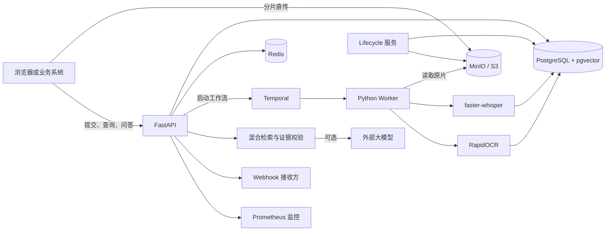

# Video Evidence Agent 项目介绍

## 一、项目概述

Video Evidence Agent 是一套面向中文课程、培训和会议视频的可核验知识问答系统。它将视频中的语音和幻灯片内容转化为带时间区间的结构化证据，并基于这些证据回答用户问题。

与只输出摘要或转写文本的工具不同，本项目强调“答案可追溯”：每条回答都可以附带语音或画面文字证据，用户点击后能够跳转到原视频对应时间点进行复核；当视频中缺少足够依据时，系统会明确拒答，降低无依据生成带来的风险。

## 二、项目背景

课程录像、内部培训、产品宣讲和会议录屏通常包含大量有价值的信息，但传统使用方式存在几个明显问题：

- 视频内容线性展开，查找某个知识点需要反复拖动进度条；
- 单纯语音转写会遗漏幻灯片、公式、标题和图中文字；
- 普通大模型问答可能给出看似合理、但无法从原视频验证的回答；
- 大文件上传、长时间解析、任务中断恢复和多租户隔离增加了工程落地难度。

Video Evidence Agent 围绕这些问题建立了从上传、解析、索引到问答和回看的一体化链路，使长视频内容能够被快速检索、准确定位和人工复核。

## 三、项目目标

项目的核心目标包括：

1. 同时理解视频中的中文语音与幻灯片文字；
2. 为识别结果保留精确的起止时间，形成可回放的证据；
3. 通过关键词与语义向量融合，提高中文内容检索效果；
4. 让回答严格建立在检索到的证据上，并在证据不足时拒答；
5. 支持大文件分片上传、异步处理、失败重试和断点恢复；
6. 提供多租户鉴权、限流、监控、数据清理和发布验收能力，满足从演示到工程部署的需要。

## 四、核心功能

### 4.1 大文件分片直传

客户端通过预签名 URL 将视频分片直接上传到 MinIO 或兼容 S3 的对象存储，文件内容不经过 API 服务转发。系统支持上传进度查询、断点续传、过期会话清理和上传完成后的大小校验。

### 4.2 异步视频解析

视频提交后由 Temporal 编排长时间运行的处理任务。Worker 并行执行语音转写与幻灯片 OCR，并通过心跳、重试和持久化工作流状态应对进程重启或临时依赖故障。

### 4.3 双模态证据提取

- 语音证据：使用 faster-whisper 提取中文语音文本及时间区间；
- 画面证据：按时间抽取视频帧，使用 RapidOCR 识别幻灯片和画面文字；
- 证据入库：统一保存证据类型、文本、起止时间和关联对象，供后续检索与回放使用。

### 4.4 中文混合检索

系统先对文本进行繁简归一化，再融合字符二元组关键词匹配与 BGE 中文向量检索。返回结果包含关键词分数、向量分数和融合分数，既兼顾专有名词的精确匹配，也兼顾自然语言问题的语义召回。

### 4.5 可核验问答

问答模块只使用通过校验的候选证据生成结果。未配置外部模型时，系统直接返回最相关的原文证据；配置兼容 Chat Completions 的模型服务后，可基于证据生成更自然的回答。响应同时返回引用、时间区间和短时有效的原片播放地址。

### 4.6 证据播放器工作台

项目自带浏览器工作台，可完成文件选择、SHA-256 计算、分片上传、任务提交、状态轮询和问题查询。点击回答下方的证据即可跳转到原视频对应位置，形成“提问—回答—引用—原片复核”的完整体验。

### 4.7 安全与运维能力

系统提供 API Key 与权限范围控制、租户隔离、幂等提交、Redis 分布式限流、租户队列配额、签名 Webhook、健康检查和 Prometheus 指标。生命周期服务按照配置自动清理过期上传、失败任务、原片和证据，并巡检数据库与对象存储的一致性。

## 五、系统架构



系统采用 API、工作流编排、计算 Worker、数据存储和生命周期管理相分离的设计。上传流量直接进入对象存储，减少 API 带宽压力；长任务由 Temporal 保留进度；业务数据与向量索引统一存储在 PostgreSQL 中；Redis 用于跨进程限流。

## 六、典型业务流程

1. 用户选择视频，客户端计算文件 SHA-256；
2. 客户端创建上传会话，并将视频按 16 MiB 分片直传对象存储；
3. 上传完成后，客户端提交视频解析任务及幂等键；
4. Temporal 调度 Worker 校验原片，并行执行 ASR 与 OCR；
5. 系统将带时间区间的证据写入数据库并建立检索索引；
6. 用户用自然语言提问，系统检索并校验证据；
7. 系统返回答案、证据引用和播放地址；
8. 用户点击证据，播放器跳转到原片对应位置；
9. 若没有可靠证据，系统返回“无法从视频中确认”。

## 七、技术选型

| 领域 | 技术 | 主要用途 |
| --- | --- | --- |
| API 服务 | Python 3.12、FastAPI | 接口、参数校验、鉴权与工作台托管 |
| 工作流 | Temporal | 长任务编排、状态持久化、重试与取消 |
| 关系与向量数据 | PostgreSQL、pgvector | 元数据、证据、审计数据和向量索引 |
| 对象存储 | MinIO / S3 API | 原始视频、抽帧图片和临时对象 |
| 缓存与限流 | Redis | 多实例共享的租户级滑动窗口限流 |
| 语音识别 | faster-whisper | 中文语音转写与时间定位 |
| 画面识别 | RapidOCR、ONNX Runtime | 幻灯片和视频画面文字识别 |
| 向量模型 | BAAI/bge-small-zh-v1.5 | 中文语义向量生成与召回 |
| 监控 | Prometheus Client | API、队列和处理阶段指标采集 |
| 部署 | Docker Compose | 本地及单机环境的一键编排 |

## 八、项目亮点

- **答案可验证**：回答关联原始证据与时间戳，可直接回到视频核验；
- **语音与画面互补**：同时利用讲解内容和幻灯片文字，减少单一模态的信息遗漏；
- **证据不足即拒答**：把“无法确认”作为正式结果，控制无依据回答；
- **面向长任务设计**：通过 Temporal 工作流、幂等机制和可恢复状态提高处理可靠性；
- **适配中文内容**：支持繁简归一化，并融合中文关键词和语义向量检索；
- **具备交付基础**：覆盖鉴权、租户隔离、限流、Webhook、指标、数据保留和自动化验收。

## 九、适用场景

- 在线教育：从课程录像中定位知识点、概念解释和板书内容；
- 企业培训：查询制度培训、产品培训和操作演示中的具体说明；
- 会议知识库：回查会议结论、发言内容和演示材料；
- 客服与合规：从录屏或培训材料中查找可复核的依据；
- 媒体资料管理：为大量中文视频建立可搜索、可引用的内容索引。

## 十、可靠性与安全设计

- 解析前复核原片 SHA-256，避免内容与提交信息不一致；
- 相同租户、文件哈希和解析版本可复用已完成结果；
- API Key 仅保存 PBKDF2-SHA256 哈希，并支持权限范围、轮换、吊销与审计；
- 所有核心查询实施租户过滤，防止跨租户访问；
- Webhook 仅允许公开 HTTPS 地址，并针对私网地址、重定向和 DNS 重绑定进行限制；
- 生产环境拒绝默认对象存储凭据、默认 Webhook 密钥和不安全的 Redis 配置；
- `/health/live` 与 `/health/ready` 分离进程存活和依赖就绪状态；
- 原片与证据支持独立保留期限，删除与异常中断可安全重试。

## 十一、当前完成情况

当前仓库已形成可运行的端到端版本，具备以下交付物：

- 完整的视频上传、解析、检索、问答和证据回放链路；
- 面向语音、幻灯片与无依据问题的端到端验收脚本；
- 覆盖鉴权、租户隔离、幂等、Webhook、安全边界、可观测性和数据生命周期的测试；
- Docker Compose 编排、Alembic 数据库迁移和持续集成配置；
- 容量测试脚本、评测指标脚本和离线/在线发布门禁。

仓库现有离线发布报告显示，交付文件、Python 版本、自动化测试和 Docker Compose 配置检查均已通过。该结果说明当前版本具备演示和进一步部署验证的基础，但不等同于生产环境容量或识别准确率承诺。

## 十二、部署与运行

本地运行需要 Docker Desktop。准备环境变量后可启动完整服务：

```powershell
Copy-Item .env.example .env
docker compose up -d --build
docker compose ps
```

启动后：

- 工作台与 API：`http://localhost:8000`
- MinIO 控制台：`http://localhost:9001`
- API 文档：`http://localhost:8000/docs`

首次运行语音识别、OCR 或向量模型时可能需要下载模型。正式部署前必须替换默认数据库密码、对象存储凭据、Webhook 密钥，并通过密钥管理脚本创建业务 API Key。

## 十三、当前边界与后续方向

当前版本仍有以下边界：

- ASR 与 OCR 效果受视频音质、口音、分辨率、字幕遮挡和幻灯片版式影响；
- 当前效果评测集主要用于开发验收，对外发布准确率前应建立独立复核的封存测试集；
- 大规模视频库和高并发环境需要根据真实硬件、视频长度与模型配置重新压测；
- 当前以租户队列配额和 Worker 总并发控制资源，尚未实现加权优先级调度与完整的模型费用预算；
- Docker Compose 适合开发、演示和单机部署，生产环境建议迁移到具备网络隔离、密钥管理、弹性伸缩和集中监控的编排平台。

后续可继续建设自动摘要、章节切分、多视频联合检索、说话人识别、领域词表、人工证据修订、权限分级和独立评测平台，逐步将系统扩展为组织级视频知识库。

## 十四、项目价值

Video Evidence Agent 的价值不只是“让视频可以问答”，而是把非结构化视频转化为能够搜索、引用和复核的知识资产。它在提升信息获取效率的同时，为每个回答保留证据链，使 AI 结果更透明，也更适合教育、企业知识管理和需要审计依据的业务场景。
