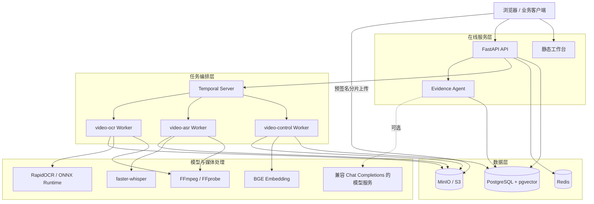
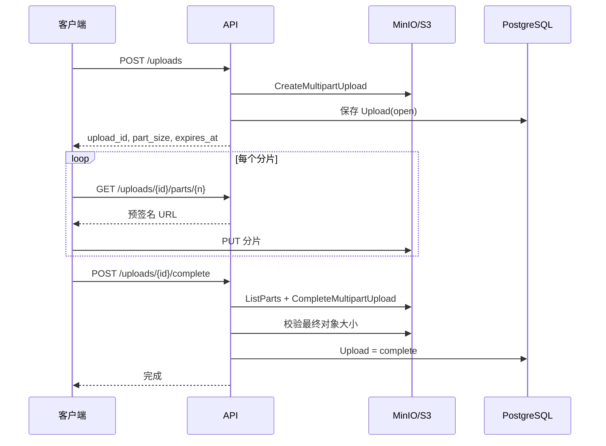
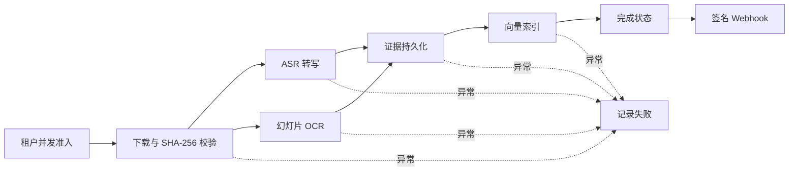
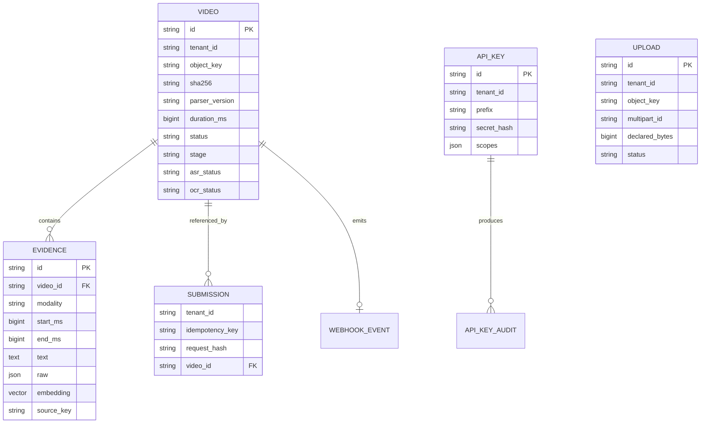
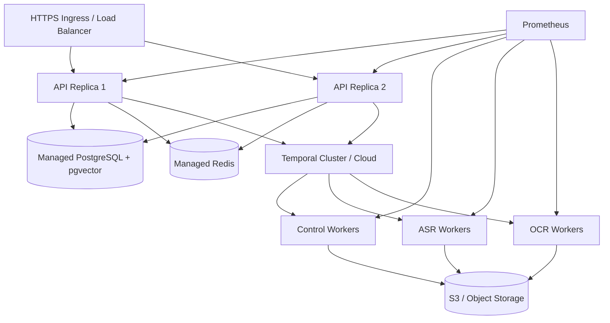

# Video Evidence Agent 技术设计与部署文档

## 1. 文档说明

本文面向后端开发、算法工程、测试和运维人员，详细说明 Video Evidence Agent 的技术架构、后端服务、Agent 问答机制、视频解析流水线、数据存储、安全措施、容器化部署、监控与生产化方案。

本文以当前仓库实现为准。项目默认使用 Docker Compose 提供一套可运行的单机环境；生产部署部分是在现有实现基础上的推荐拓扑，不代表仓库已经包含 Kubernetes 清单或云厂商资源模板。

## 2. 技术目标与设计原则

系统需要处理体积较大的视频文件和运行时间较长的模型任务，同时保证回答能够被原视频验证。因此采用以下设计原则：

- 上传与 API 解耦：客户端通过预签名 URL 直传对象存储；
- 在线请求与离线计算解耦：API 只负责提交任务，解析由 Temporal Worker 异步执行；
- 语音与画面并行：ASR 和 OCR 使用独立任务队列与并发限制；
- 证据优先：Agent 只能引用当前视频中通过校验的证据；
- 可降级：向量模型不可用时保留关键词检索，未配置大模型时返回抽取式答案；
- 可恢复：上传完成、任务提交、解析持久化和 Webhook 均考虑幂等或安全重试；
- 多租户隔离：租户身份由 API Key 绑定，不信任客户端自行声明；
- 可观测：为 HTTP、队列等待、处理阶段、模型、存储和数据库连接池提供指标。

## 3. 总体架构



### 3.1 服务职责

| 服务 | 职责 | 是否保存业务状态 |
| --- | --- | --- |
| API | 鉴权、上传会话、任务提交、状态查询、问答、指标和静态工作台 | 否，状态写入 PostgreSQL、Redis、Temporal 和对象存储 |
| Worker | 文件校验、ASR、OCR、证据持久化、向量索引和 Webhook | 仅保留有大小上限的本地媒体缓存 |
| Lifecycle | 数据保留期清理和数据库/对象存储一致性修复 | 否 |
| PostgreSQL | 租户业务数据、任务状态、证据、API Key、审计和向量 | 是 |
| MinIO | 原始视频、OCR 截图和分片上传对象 | 是 |
| Temporal | 工作流事件历史、Activity 重试和任务状态 | 是 |
| Redis | 多 API 实例共享的滑动窗口限流数据 | 短期状态 |

## 4. 后端 API 技术

### 4.1 FastAPI 应用

API 使用 Python 3.12、FastAPI、Pydantic 和 SQLAlchemy 2.x。应用生命周期启动时会：

1. 执行 Alembic 数据库迁移；
2. 将旧版明文引导密钥导入为哈希 API Key；
3. 连接 Temporal；
4. 启动待派发任务补偿循环；
5. 启动过期上传清理循环。

每个 HTTP 响应包含 `X-Request-Id`。调用方传入该请求头时会沿用，否则服务生成新值；服务日志记录方法、路径、状态码和耗时，便于定位一次请求在系统内的行为。

### 4.2 主要接口

| 方法与路径 | Scope | 作用 |
| --- | --- | --- |
| `GET /health/live` | 无 | 检查 API 进程是否存活 |
| `GET /health/ready` | 无 | 检查 PostgreSQL、MinIO、Temporal 和 Redis |
| `POST /uploads` | `uploads:write` | 创建分片上传会话 |
| `GET /uploads/{id}` | `uploads:write` | 查询服务端实际存在的分片，用于续传 |
| `GET /uploads/{id}/parts/{n}` | `uploads:write` | 获取指定分片的预签名上传 URL |
| `POST /uploads/{id}/complete` | `uploads:write` | 合并并校验分片 |
| `DELETE /uploads/{id}` | `uploads:write` | 取消未关联视频的上传 |
| `POST /videos` | `videos:write` | 创建异步解析任务 |
| `GET /jobs/{id}` | `videos:read` | 查询任务及 ASR/OCR 分支状态 |
| `DELETE /videos/{id}` | `videos:write` | 取消工作流并删除相关数据 |
| `POST /videos/{id}/questions` | `questions:ask` | 针对已解析视频提问 |
| `GET /metrics` | 网络白名单，可选 Bearer Token | 输出 Prometheus 指标 |

FastAPI 自动生成的 OpenAPI 页面位于 `/docs`。根路径 `/` 返回内置的证据播放器工作台。

### 4.3 上传协议

分片大小固定为 16 MiB。上传过程如下：



上传完成阶段使用 `completing` 中间状态。如果对象存储已完成合并，但数据库提交中断，客户端可以安全重试；API 会先检查最终对象是否已经存在，再完成数据库对账。系统同时校验分片编号连续性、分片大小和最终文件大小。

### 4.4 任务提交与幂等

创建视频任务必须携带 `Idempotency-Key`。数据库在 `(tenant_id, idempotency_key)` 上设置唯一约束：

- 相同键和相同请求返回原任务；
- 相同键对应不同请求返回 `409`；
- 相同租户、文件 SHA-256 和解析版本已有完成结果时，可以复用结果；
- 新任务先以 `dispatch_pending` 状态提交到数据库，再尝试启动 Temporal；
- 后台补偿循环会重新派发未成功交给 Temporal 的任务。

Temporal 工作流 ID 固定为 `video-{video_id}`，进一步避免重复启动。

## 5. Agent 问答技术

### 5.1 Agent 的边界

本项目中的 Agent 是一个受证据约束的后端问答 Agent，而不是可以任意调用工具、修改外部系统的通用自治 Agent。它完成四个逻辑阶段：

```text
classify → retrieve → verify → extract / generate / abstain
```

- `classify`：当前实现以问答入口和视频范围作为隐式分类，不单独调用分类模型；
- `retrieve`：从当前视频的语音和幻灯片证据中执行混合检索；
- `verify`：校验证据所属视频与时间区间；
- `extract`：未配置 LLM 时返回最相关的证据原文；
- `generate`：配置 LLM 时仅基于候选证据生成答案；
- `abstain`：无候选证据、模型失败或模型未返回有效引用时拒答。

返回值中的 `trace` 会表明实际走过的路径，便于评测和故障分析。

### 5.2 文本规范化与关键词检索

系统使用 OpenCC 将查询和证据转换为简体中文视图，但数据库仍保留原始识别文本。中文检索不依赖分词器，而是生成字符二元组；英文与数字串通过正则作为独立 term。

对较长问题，系统同时要求绝对重叠数量和比例达到阈值，避免只因“是否”等常见词命中。关键词分数计算为：

```text
keyword_score = 查询 term 与证据 term 的交集数量 / 查询 term 数量
```

### 5.3 向量检索

默认向量模型为 `BAAI/bge-small-zh-v1.5`，通过 FastEmbed 在本地生成 512 维向量。入库时会将相邻证据片段拼接成短上下文，以缓解 Whisper 短句缺少语境的问题，但向量仍关联到原证据记录。

查询向量通过 pgvector 的余弦距离与证据向量比较：

```text
vector_score = max(0, 1 - cosine_distance)
```

数据库为向量列建立 HNSW 余弦索引。若模型加载、模型缓存或向量查询失败，接口不会整体失败，而是退回关键词检索；对应证据可通过重建索引脚本后续补齐。

### 5.4 混合排序

默认融合公式为：

```text
fused_score = 0.55 × keyword_score + 0.45 × vector_score
```

权重由 `RETRIEVAL_KEYWORD_WEIGHT` 与 `RETRIEVAL_VECTOR_WEIGHT` 配置。纯向量结果必须达到 `RETRIEVAL_VECTOR_THRESHOLD`，默认值为 `0.58`。结果先按融合分数降序排列，同分时按视频时间升序排列。

### 5.5 证据校验

候选证据必须同时满足：

- `evidence.video_id == 当前 video.id`；
- `0 <= start_ms < end_ms <= video.duration_ms`。

该校验阻止跨视频引用和越界时间戳进入回答。最终最多向 Agent 提供 `MAX_EVIDENCE_COUNT` 条证据。

### 5.6 LLM 生成模式

配置 `MODEL_API_URL`、`MODEL_API_KEY` 和 `MODEL_NAME` 后启用生成模式。模型端点需兼容 Chat Completions 请求结构，并支持 JSON Object 输出。系统提示要求模型仅依据证据回答，并输出：

```json
{
  "answer": "根据证据生成的答案",
  "citation_ids": ["允许的证据 ID"]
}
```

服务端不会直接信任模型返回的引用，而是用候选证据 ID 白名单再次过滤。如果答案为空、没有合法引用、响应格式错误、请求超时或模型返回错误，Agent 统一降级为拒答。

大模型并发由进程内 `asyncio.Semaphore` 控制，默认并发为 2；请求默认超时 30 秒，最大输出 800 token。调用外部模型期间数据库连接已经释放，避免长请求占用连接池。

### 5.7 抽取式模式

未设置 `MODEL_API_URL` 时不调用外部模型。Agent 将得分最高的证据原文作为答案，并返回全部通过校验的候选引用。这种方式成本低、可解释性强，适合离线环境、演示和敏感数据场景。

## 6. 视频解析技术

### 6.1 Temporal 工作流

每个视频对应一个 `VideoWorkflow`。完整模式的执行顺序如下：



普通 Activity 默认最多尝试 3 次，初始重试间隔 2 秒。ASR 与 OCR 的最长运行时间为 3 小时，并每 2 分钟要求一次 heartbeat；模型循环和 FFmpeg 处理过程持续报告进度，从而支持故障检测与取消。

`PROCESSING_MODE=smoke` 时只验证上传、校验、工作流、持久化和通知链路，不执行 ASR/OCR，主要用于 CI 和基础设施验收。

### 6.2 Worker 队列与并发隔离

单个 Worker 进程同时监听四类队列：

| 队列 | 任务 | 并发来源 |
| --- | --- | --- |
| `video-control` | 准入、准备、持久化、索引、通知、失败处理 | 固定控制线程池 |
| `video-asr` | Whisper 转写 | `ASR_CONCURRENCY`，默认 1 |
| `video-ocr` | 抽帧与 OCR | `OCR_CONCURRENCY`，默认 2 |
| `video-jobs` | 兼容升级前的工作流历史 | 固定控制线程池 |

独立队列避免 CPU/内存较重的 OCR 任务挤占 ASR 资源，也允许生产部署时将不同队列拆到不同硬件节点。旧 `video-jobs` 队列用于平滑升级，待旧工作流历史全部处理后才能停止监听。

### 6.3 原片缓存

Worker 将对象存储中的原片下载到本地缓存目录，使 SHA-256 校验、ASR 和 OCR 通常共享一次下载。并发访问同一视频时使用进程内锁，下载先写 `.part` 临时文件，再通过原子替换发布。

缓存采用近似 LRU 清理：每次访问更新时间，按修改时间删除旧文件，直到总大小不超过 `MEDIA_CACHE_MAX_BYTES`，默认 8 GiB。多 Worker 副本不共享本地缓存，因此每个实际处理副本可能各自下载一份原片。

### 6.4 媒体探测与限制

系统优先使用 `ffprobe` 获取视频时长；不可用时回退到 ImageIO 提供的 FFmpeg。视频时长必须大于 0 且不超过 `MAX_VIDEO_SECONDS`，默认 3 小时。上传文件大小默认不超过 2 GiB。

在解析前，Worker 对下载后的完整文件重新计算 SHA-256，与任务提交值比对。校验失败会删除本地缓存并终止任务。

### 6.5 ASR 流程

1. FFmpeg 将原视频转换为 16 kHz、单声道 WAV；
2. faster-whisper 加载配置的 Whisper 模型，默认 `small`；
3. 使用中文语言参数与 VAD 过滤执行转写；
4. 为每段结果保存 `start_ms`、`end_ms`、文本和模型信息；
5. 每处理一个片段发送 Temporal heartbeat。

当前镜像默认采用 CPU `int8` 推理。若部署到 GPU，需要选择与 CUDA 环境匹配的运行时镜像、模型依赖与 Worker 节点，并在上线前重新验证性能和兼容性。

### 6.6 OCR 流程

1. 按 10 秒间隔遍历视频；
2. FFmpeg 抽取一帧并缩放至 960 像素宽；
3. 将帧转灰度并缩放到 32×32，计算与上一有效帧的平均像素差；
4. 像素差小于 10 时视为近似重复画面并跳过；
5. 使用 RapidOCR 识别文字；
6. 保存 OCR 原始结果、帧变化值、时间区间和截图对象键；
7. 截图上传到 `frames/{video_id}/{start_ms}.jpg`。

当前实现是固定间隔抽帧与轻量去重，适合幻灯片型视频。对于快速切换、手写板书或高动态画面，可进一步引入场景切分、关键帧检测和版面分析。

### 6.7 证据持久化与索引

ASR 和 OCR 完成后，结果按起始时间排序并写入 `evidences`。持久化 Activity 在发现该视频已存在证据时直接返回，从而保证重试不会重复写入。

索引阶段为尚无向量的证据生成 embedding。若向量模型不可用，证据状态标记为 `deferred`，视频仍可完成，关键词问答仍然可用；运维可使用 `scripts/day3_reindex.py` 重新建立向量。

## 7. 数据模型



关键约束包括：

- `videos.object_key` 唯一；
- `(videos.tenant_id, sha256, parser_version)` 建立检索索引；
- `(submissions.tenant_id, idempotency_key)` 唯一；
- `api_keys.prefix` 唯一；
- `webhook_events.video_id` 唯一；
- `evidences(video_id, start_ms)` 建立时间索引；
- evidence embedding 使用 512 维 pgvector 字段和 HNSW 索引。

数据库变更由 Alembic 管理。API、Worker 和维护服务启动时都会升级到 `head`，迁移文件随 Python 包一同发布。

## 8. 鉴权、多租户与流量控制

### 8.1 API Key

新 API Key 格式为：

```text
vak_<prefix>.<secret>
```

数据库只保存 prefix 与使用 600,000 次 PBKDF2-SHA256 计算的密钥哈希。明文密钥仅在创建或轮换时显示一次。系统支持：

- 创建带 scope 和过期时间的密钥；
- 轮换密钥并配置旧密钥宽限期；
- 立即吊销；
- 查询密钥列表；
- 查询认证与授权审计事件。

可用 scope 为 `uploads:write`、`videos:write`、`videos:read` 和 `questions:ask`。

### 8.2 租户绑定

租户 ID 由通过验证的 API Key 记录提供。兼容客户端可发送 `X-Tenant-Id`，但它只能与密钥绑定的租户一致，不能用于切换租户。视频、上传、提交和查询均执行租户条件检查。

### 8.3 Redis 滑动窗口限流

API 使用 Redis Sorted Set 和 Lua 脚本原子实现 60 秒滑动窗口，默认限制为：

- 上传初始化：每租户每分钟 30 次；
- 视频提交：每租户每分钟 10 次；
- 视频问答：每租户每分钟 60 次。

超限返回 `429` 与准确的 `Retry-After`。Redis 不可用时返回 `503`，不会静默放开限流。

### 8.4 队列和运行并发

提交任务时使用 PostgreSQL 租户级 advisory transaction lock，原子检查等待任务数量，默认每租户最多排队 20 个任务。工作流开始时使用另一把租户锁检查运行中任务，默认每租户并行 2 个。

这一设计控制单个租户对共享资源的占用。生产环境如需不同服务等级，可在此基础上增加租户权重、独立队列或配额表。

## 9. Webhook 安全

任务结束后，系统可向提交时指定的 URL 发送：

```json
{
  "event_id": "事件 ID",
  "video_id": "视频 ID",
  "status": "complete"
}
```

原始请求体使用共享密钥计算 HMAC-SHA256，摘要放在 `X-Signature-SHA256`。接收端应先验证签名，再按 `event_id` 去重。

为降低 SSRF 与 DNS 重绑定风险，发送端：

- 仅接受标准 443 端口的 HTTPS URL；
- 在提交时和发送前解析全部 DNS 结果；
- 拒绝私网、回环、链路本地和保留地址；
- 实际连接到已验证的 IP，同时保留原 Host 与 TLS SNI；
- 不跟随重定向；
- 限制连接/读取超时和响应体大小。

非 2xx 响应或网络失败会由 Temporal 重试。数据库为每个视频只保留一个 Webhook 事件，并记录投递次数与状态。

## 10. 配置管理

配置通过 Pydantic Settings 从环境变量和 `.env` 读取。重要配置分组如下：

| 分组 | 关键变量 |
| --- | --- |
| 数据库与存储 | `DATABASE_URL`、`S3_ENDPOINT`、`S3_ACCESS_KEY`、`S3_SECRET_KEY`、`S3_BUCKET` |
| 工作流与限流 | `TEMPORAL_ADDRESS`、`REDIS_URL`、`TENANT_CONCURRENCY`、`TENANT_QUEUE_QUOTA` |
| 解析模型 | `PROCESSING_MODE`、`ASR_MODEL`、`OCR_MODEL`、`EMBEDDING_MODEL`、`EMBEDDING_CACHE_DIR` |
| Agent | `MODEL_API_URL`、`MODEL_API_KEY`、`MODEL_NAME`、`MAX_EVIDENCE_COUNT`、`LLM_TIMEOUT_SECONDS` |
| 检索 | `RETRIEVAL_KEYWORD_WEIGHT`、`RETRIEVAL_VECTOR_WEIGHT`、`RETRIEVAL_VECTOR_THRESHOLD` |
| 安全 | `APP_ENVIRONMENT`、`WEBHOOK_SECRET`、`METRICS_TOKEN`、`METRICS_ALLOWED_NETWORKS` |
| 生命周期 | `INCOMPLETE_UPLOAD_RETENTION_HOURS`、`FAILED_JOB_RETENTION_DAYS`、`ORIGINAL_RETENTION_DAYS`、`EVIDENCE_RETENTION_DAYS` |

当 `APP_ENVIRONMENT=production` 时，配置校验会拒绝默认 MinIO 凭据、默认 Webhook 密钥、无认证 Redis，以及既没有监控 token 又允许非回环网络访问指标接口的配置。

## 11. 本地开发部署

### 11.1 前置条件

- Docker Desktop 或兼容 Docker Engine；
- Docker Compose v2；
- 如需在宿主机运行测试：Python 3.12；
- 首次 full 模式运行需要能够获得 Whisper、OCR 和 embedding 模型文件。

### 11.2 使用 Docker Compose 启动

```powershell
Copy-Item .env.example .env
# 编辑 .env，至少替换数据库、MinIO、Redis 和 Webhook 密钥
docker compose up -d --build
docker compose ps
```

默认端口：

| 地址 | 用途 |
| --- | --- |
| `http://localhost:8000` | 工作台与 API |
| `http://localhost:8000/docs` | OpenAPI 文档 |
| `http://localhost:9000` | MinIO S3 API |
| `http://localhost:9001` | MinIO 控制台 |
| `localhost:5432` | PostgreSQL |
| `localhost:7233` | Temporal Frontend |

查看运行日志：

```powershell
docker compose logs -f api worker lifecycle
```

停止服务但保留数据：

```powershell
docker compose down
```

删除 Compose 数据卷会永久删除本地数据库和对象存储数据，不应作为常规停止方式。

### 11.3 宿主机开发

```powershell
python -m venv .venv
.\.venv\Scripts\python -m pip install -e ".[test,processing]" -c requirements.lock
.\.venv\Scripts\python -m uvicorn video_agent.api:app --reload
```

另一个终端启动 Worker：

```powershell
.\.venv\Scripts\python -m video_agent.worker
```

PostgreSQL、MinIO、Temporal 和 Redis 仍可由 Docker Compose 提供。宿主机进程需要使用 `.env.example` 中面向 `localhost` 的连接地址。

### 11.4 创建业务 API Key

```powershell
python scripts/api_keys.py create `
  --tenant team-42 `
  --name development `
  --scope uploads:write `
  --scope videos:write `
  --scope videos:read `
  --scope questions:ask
```

生成的完整密钥只显示一次，应立即保存到安全的密钥管理位置。`API_KEY` 环境变量仅用于兼容旧部署的一次性引导，不应作为长期密钥管理方式。

## 12. 容器镜像设计

Dockerfile 使用双阶段构建：

1. Builder 阶段根据 `requirements.lock` 构建项目和依赖 wheel；
2. Runtime 阶段只安装 wheel、FFmpeg 和必要系统库；
3. 应用以 UID/GID 10001 的非 root 用户运行；
4. 容器设置只读根文件系统，`/tmp` 使用 tmpfs；
5. 模型缓存挂载到独立 `model-cache` 卷。

API、Worker、初始化任务、数据库迁移和 Lifecycle 共用同一镜像，通过不同启动命令形成不同角色。这降低了版本漂移，但镜像会包含处理依赖，体积相对纯 API 镜像更大。规模扩大后可拆分 API 轻量镜像与模型 Worker 镜像。

## 13. Compose 服务编排

当前 Compose 包含：

- `postgres`：PostgreSQL 16 + pgvector；
- `redis`：带密码的 Redis 7.4；
- `minio`：S3 兼容对象存储；
- `temporal`：使用 PostgreSQL 作为后端的 Temporal Server；
- `minio-init`：一次性创建 bucket；
- `db-migrate`：一次性执行数据库迁移；
- `api`：FastAPI 在线服务；
- `worker`：Temporal Worker 与 9091 指标端口；
- `lifecycle`：周期性保留期与一致性维护服务。

API 使用依赖条件等待数据库健康、迁移完成、Redis 健康、Temporal 健康和 bucket 初始化完成。所有长期服务配置 `restart: unless-stopped` 并设置资源上限。

## 14. 生产部署建议

### 14.1 推荐拓扑



生产环境建议：

- API 无状态化，部署至少两个副本并通过负载均衡器提供 HTTPS；
- PostgreSQL 使用高可用实例、自动备份和连接池代理；
- Redis 使用带认证、TLS 和故障转移的托管实例；
- 对象存储使用私有 bucket、服务身份、服务端加密和独立生命周期策略；
- Temporal 使用高可用集群或托管服务；
- 将 control、ASR、OCR Worker 拆成独立部署，按队列和硬件资源伸缩；
- 模型文件通过构建阶段预热、只读共享缓存或节点缓存提供，避免启动时集中下载；
- 所有密钥存入 Secret Manager，不写入镜像、Git 或普通 ConfigMap；
- 仅通过内部网络暴露 PostgreSQL、Redis、Temporal、MinIO 管理端口和 Worker 指标端口。

### 14.2 Agent 服务部署

Agent 目前嵌入 API 进程，适合中小规模部署。其资源消耗主要来自 embedding 查询和可选外部 LLM 请求。

部署时需要注意：

- 每个 API 副本都有独立的 `LLM_CONCURRENCY` 信号量，集群总并发约为副本数乘以该值；
- 若需要全局 LLM 配额，应使用网关、Redis 信号量或独立 Agent 服务；
- embedding 模型会在首次需要时加载到 API 进程，增加内存占用和冷启动时间；
- 若 API 副本较多，可将向量生成迁移到独立服务，在线查询继续使用数据库向量；
- 外部 LLM 端点必须设置网络超时、服务端限流、费用告警和数据合规策略；
- 对敏感视频可保持抽取式模式，完全不向外部模型发送证据文本。

当问答流量或模型治理需求显著增加时，可将 `answer_candidates` 封装为独立 Agent 服务。API 只发送问题和候选证据，Agent 服务负责模型路由、全局配额、提示词版本、内容审计和模型指标。拆分时仍应由 API 或可信中间层校验证据白名单，不能把跨租户检索权限交给模型服务。

### 14.3 Worker 扩缩容

Temporal 队列天然支持多个 Worker 竞争消费。建议按任务类型分别部署：

- Control Worker：轻量，可多副本；
- ASR Worker：CPU/GPU 和内存密集，根据视频分钟数扩容；
- OCR Worker：CPU 密集，并产生较多 FFmpeg 子进程与临时图片；
- Lifecycle：保持单实例或通过分布式锁保证同一时间只有一个维护任务。

当前 `video_agent.worker` 在一个进程中启动所有队列 Worker。若要独立扩容，需要增加按角色启动的入口或命令行参数，这是生产化拆分时优先建议的代码改造。

### 14.4 数据库与迁移

生产发布不建议让每个 API/Worker 副本同时执行迁移。更稳妥的流程是：

1. 构建并验证新镜像；
2. 备份数据库；
3. 运行单独的 migration Job；
4. 先部署兼容旧工作流历史的 Worker；
5. 滚动更新 API；
6. 观察指标和错误率；
7. 确认旧工作流完成后再停止遗留队列监听。

数据库迁移应保持向后兼容，避免在同一发布步骤中立即删除旧列或更改旧 Worker 仍需的数据结构。

## 15. 可观测性

### 15.1 健康检查

- `/health/live`：只表示 API 进程能响应；
- `/health/ready`：检查数据库、对象存储、Temporal 和 Redis，任一不可用返回 `503`。

容器编排应使用 live 作为存活探针、ready 作为就绪探针，避免依赖短暂故障导致不必要的进程重启。

### 15.2 Prometheus 指标

API `/metrics` 主要提供：

- HTTP 请求量、状态和耗时；
- 限流次数；
- LLM 成功/失败次数；
- 活跃任务与各状态任务数；
- 数据库指标刷新状态；
- SQLAlchemy 连接池使用情况。

Worker 端口默认是 `9091`，主要提供：

- 队列等待时间；
- 各解析阶段耗时和成功/失败结果；
- ASR/OCR 尝试、失败和重试次数；
- Webhook 投递结果；
- 对象存储操作量和耗时。

API 指标接口受来源 CIDR 白名单保护，并可额外要求 Bearer Token。数据库聚合刷新失败时仍返回进程指标和上次快照，同时将数据库可用指标置为 0。

### 15.3 推荐告警

- ready 连续失败；
- `dispatch_pending` 或 queued 数量持续增长；
- 队列等待时间 P95 超过业务目标；
- ASR/OCR Activity 失败率或重试率升高；
- Webhook 连续失败；
- Redis、数据库或对象存储操作错误；
- LLM 失败率、超时率或用量异常；
- 数据库连接池接近耗尽；
- Worker 内存、临时磁盘或模型缓存空间不足。

## 16. 数据生命周期与删除

Lifecycle 服务默认每小时执行一次，处理：

- 24 小时前未完成且未被视频引用的上传；
- 7 天前失败的任务；
- 90 天前的原始视频；
- 90 天前的视频证据与相关记录；
- 超过宽限期且数据库没有引用的对象和 multipart upload；
- 数据库引用但对象存储丢失的原片或截图。

原片和证据保留期相互独立。原片删除后，文本证据仍可查询，但回答的 `playback_url` 为 `null`；证据保留期到期后，任务、证据、提交记录、Webhook 记录和相关对象整体删除。

一致性巡检发现原片丢失时将任务标记为失败；发现截图丢失时清空对应证据的 `source_key`，但保留文本证据。

## 17. 测试、评测与发布门禁

### 17.1 自动化测试

仓库测试覆盖配置、鉴权、API 边界、Agent、工作流状态、健康检查、限流、指标、迁移打包、工作台、Webhook、存储、检索、断点上传、处理依赖和可观测性。

运行测试：

```powershell
.\.venv\Scripts\python -m pytest -q --basetemp .tmp\pytest-local
```

### 17.2 分层验收脚本

| 脚本 | 目的 |
| --- | --- |
| `scripts/day1_smoke.py` | 上传与工作流基础链路 |
| `scripts/day2_e2e.py` | 真实 ASR/OCR、证据问答与拒答 |
| `scripts/day3_eval.py` | Recall@5、MRR、时间 IoU、拒答和证据支持率 |
| `scripts/day5_acceptance.py` | 安全、幂等、租户隔离、Webhook 和完整链路 |
| `scripts/day6_load.py` | 并发上传、解析和问答容量基线 |
| `scripts/day7_release_check.py` | 文件、测试、Compose 与在线服务发布门禁 |

### 17.3 CI

GitHub Actions 包含：

- Unit Job：安装完整依赖、运行 pytest、Python 编译检查和 Compose 配置校验；
- Integration Job：以 smoke 模式构建并启动完整 Compose 环境，执行上传工作流和在线发布门禁，失败时输出关键服务日志。

依赖版本由 `requirements.lock` 约束。修改 `pyproject.toml` 后应重新生成并提交锁文件，以保持 CI 与镜像构建一致。

## 18. 性能与容量考虑

性能瓶颈通常不在 FastAPI，而在视频下载、FFmpeg、ASR、OCR、embedding 和外部 LLM。容量评估应至少记录：

- 不同视频长度、编码和分辨率下的实时处理倍率；
- ASR 与 OCR 的 CPU、GPU、内存峰值；
- 单 Worker 本地缓存和临时磁盘需求；
- 对象存储吞吐与请求量；
- PostgreSQL evidence 数量、HNSW 索引大小和查询延迟；
- API 问答 P50/P95/P99 延迟；
- 外部 LLM 延迟、错误率、token 和费用；
- 多租户情况下的队列等待和公平性。

当前默认配置偏向单机演示与受控负载，不能直接视为生产容量结论。应分别使用短、中、长视频运行 `day6_load.py`，并结合容器和 Prometheus 指标确定实际并发。

## 19. 故障处理

### 19.1 上传中断

客户端重新调用 `GET /uploads/{id}` 获取已存在分片，只上传缺失编号，然后重新 complete。会话过期返回 `410`，需要创建新会话。

### 19.2 API 提交后没有进入处理

检查视频 stage 是否为 `dispatch_pending`，确认 Temporal ready 状态和 API 日志。后台补偿循环会持续重试派发，不需要重新创建业务任务。

### 19.3 Worker 重启

Temporal 保留工作流历史并重新调度 Activity。长任务 heartbeat 超时后可在其他 Worker 上重试。持久化、索引和通知均采用可重复执行设计，但本地媒体缓存可能需要重新下载。

### 19.4 向量模型失败

视频仍会完成，相关证据标为 `deferred`，问答退回关键词检索。恢复模型或缓存后运行重建索引脚本。

### 19.5 LLM 失败

当前生成模式不会自动回退到抽取式答案，而是安全拒答，并增加失败指标。这一策略避免在模型异常时改变回答语义；若业务更偏向可用性，可以显式增加“生成失败后返回首条证据”的受控降级策略。

### 19.6 对象存储数据不一致

运行：

```powershell
python -m video_agent.lifecycle --once
```

维护任务会清理孤儿对象、终止无引用的 multipart upload，并修复缺失原片或截图对应的数据库状态。

## 20. 已知技术边界与演进建议

当前主要边界与建议如下：

1. Worker 角色尚未拆分：增加 `--role control|asr|ocr`，实现按队列独立部署和伸缩；
2. LLM 并发仅为单进程限制：增加集群级配额、模型网关和费用预算；
3. OCR 使用固定 10 秒抽帧：引入镜头切分、关键帧检测和版面分析；
4. ASR 未实现说话人分离和领域词表：可增加 diarization、热词与人工校订；
5. 检索目前按单视频执行：可增加租户级多视频索引、权限过滤和 reranker；
6. Agent 流程较轻：可增加问题改写、答案一致性检查和引用覆盖率校验，但仍需保持证据白名单；
7. Compose 中基础设施适合单机：生产环境需要高可用、备份、TLS、网络策略和密钥管理；
8. 开发集不能代表生产准确率：建立独立封存集，并按视频领域、音质和画面类型分层评测。

## 21. 相关文件索引

| 文件 | 内容 |
| --- | --- |
| `video_agent/api.py` | FastAPI 接口、上传、任务、问答、健康检查和指标 |
| `video_agent/agent.py` | Agent 证据生成、抽取、拒答和 LLM 调用 |
| `video_agent/retrieval.py` | 中文关键词、向量融合与证据校验 |
| `video_agent/workflow.py` | Temporal 工作流和 Activities |
| `video_agent/worker.py` | Worker 队列、线程池和并发配置 |
| `video_agent/media.py` | FFmpeg、Whisper 和 OCR 处理 |
| `video_agent/db.py` | SQLAlchemy 数据模型 |
| `video_agent/auth.py` | API Key、scope 和审计 |
| `video_agent/telemetry.py` | Redis 限流与 Prometheus 指标 |
| `video_agent/lifecycle.py` | 数据保留和一致性修复 |
| `video_agent/webhooks.py` | Webhook URL 与网络安全校验 |
| `docker-compose.yml` | 本地完整服务编排 |
| `Dockerfile` | 应用镜像构建与运行安全配置 |
| `.env.example` | 全量环境变量示例 |
| `docs/architecture.md` | 架构摘要与现场演示顺序 |
| `docs/project-introduction.md` | 面向项目介绍和汇报的概览文档 |
